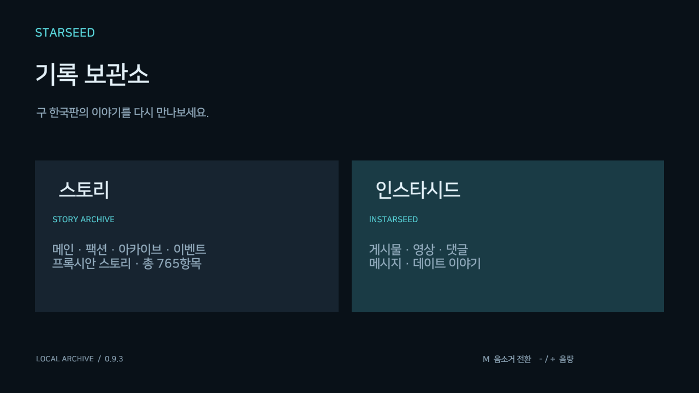
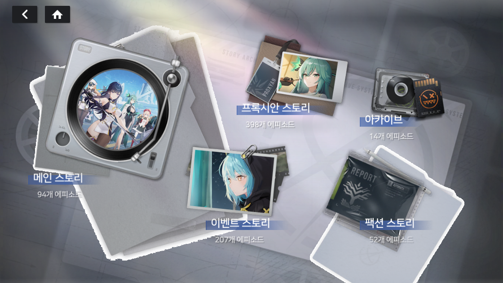
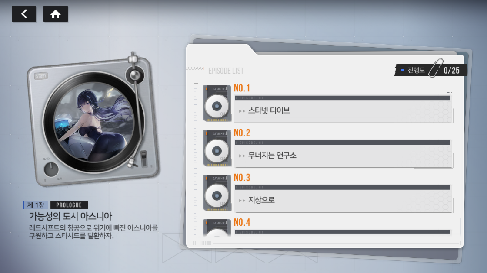

# 스타시드 구 한국판 뷰어

Windows 64비트 독립 뷰어입니다. 메인 94화, 팩션 52항목, 아카이브 14항목, 이벤트 207항목, 프록시안 일반·아카데미 398항목과 인스타시드를 제공합니다. 스토리는 총 765항목이며 데이트는 포함하지 않습니다.

## 화면 미리보기

### 메인 메뉴

### 스토리 메뉴

### 에피소드 목록

상위 메뉴·메인 에피소드 화면은 0.7.6~0.7.7, 확장된 스토리 분류 메뉴는 0.9.1 검증 빌드에서 캡처했습니다.

## 실행

1. 이 저장소를 clone하거나 Code → Download ZIP으로 받아 압축을 풉니다.
2. `StarseedOldStory.exe`를 실행합니다. 주변 DLL과 `_Data`, `MonoBleedingEdge`, `Bootstrap` 폴더를 함께 보관하세요.
3. 첫 실행에는 원본 로그인 화면에서 필요한 애셋을 자동 다운로드합니다. 완료 후 TAP TO START가 표시되면 화면을 클릭하여 메뉴로 들어갑니다. Enter/Space로도 시작할 수 있습니다.

Python, Unity Editor, Git LFS, 원본 게임이나 HIVE 로그인은 필요하지 않습니다.
배치 파일도 필요 없습니다. 쓰기 가능한 NTFS 폴더에 보관하세요.

데이터는 [별도 저장소의 Releases](https://github.com/matiasteacher12/starseed_old_data/releases)에서 받아 `Content/`에 저장합니다.
이미 설치된 정상 파일은 재사용하며 준비가 끝나면 인터넷 없이 볼 수 있습니다.
중단된 다운로드는 이어받습니다. 실패 화면에서는 연결/디스크 공간을 확인하고 Enter로 재시도하거나 Esc로 종료할 수 있습니다.
완료 기록·설정은 Windows 사용자별 뷰어 저장소에 유지되며 이 저장소에 포함하지 않습니다.

## 버전과 범위

기능 코드 0.9.1, 고정 실행부 0.9.0, 시작 UI 번들 0.7.7. 기본 애셋 0.7.6과 추가 애셋 0.9.1을 함께 사용합니다. 실행 파일과 카탈로그가 지정한 고정 릴리스 및 SHA-256만 사용합니다.
로그인 화면의 뷰어 이름은 로고 아래에 표시됩니다.
음소거(M)와 볼륨(-/=)은 저장되며 로그인 화면부터 적용됩니다. 첫 실행은 낮은 볼륨으로 시작합니다.
앱에 약 78 MB의 시작용 영상을 포함하여 첫 다운로드 중에도 재생합니다. 본래 영상의 다운로드·검증이 끝나면 현재 시간대를 이어 교체하며 음악은 계속 재생합니다. 시작용 파일이 누락/손상된 경우에는 설치된 본래 영상으로 대체합니다.

시작 UI의 작은 번들은 첫 다운로드 화면을 위해 앱에 포함하며, 배경 영상과 나머지 콘텐츠는 분리합니다.
앱을 갱신하면 새 카탈로그에 필요한 파일만 확인하고, 필요한 묶음만 받습니다.
로그인 화면에서 기능 코드 업데이트를 자동 확인합니다. 새 버전은 다운로드·SHA-256·고정 진입부 호환성 검사 후 같은 실행에서 로드합니다. 재실행 없이 TAP TO START로 이어지며, 스토리와 인스타시드가 열리면 정상 버전으로 확정합니다.
네트워크 오류·손상·호환되지 않는 업데이트는 기존 정상 버전을 유지합니다. 초기화 도중 비정상 종료된 버전은 다음 실행에 이전 버전으로 복구합니다.
코드 업데이트는 `CodeUpdates/`에, 콘텐츠는 기존 `Content/`에 저장합니다. 설정과 완료 기록은 유지됩니다.
0.8.0 이하에서 처음 넘어올 때와 고정 진입부/Unity 런타임 자체가 바뀔 때만 앱을 종료하고 `git pull` 또는 ZIP 교체가 필요합니다.

`Source/`는 뷰어 런타임 C# 소스의 해당 버전 스냅샷입니다. 전체 Unity 제작 프로젝트/원본 추출 자료는 배포에 포함하지 않습니다.
원본 게임 실행 엔진의 완전한 복원이 아니며 일부 연출 차이가 남아 있습니다.
원본 게임 애셋의 권리는 해당 권리자에게 있습니다. 포함된 런타임 라이선스는 `Notices/`를 확인하세요.

## 추가 스토리의 자료 누락

마릴라이트 이벤트 5~8화는 원본에 없는 배경 구간만 검게 표시하고 대사와 캐릭터를 이어 재생합니다. 파라·시얀의 초상화 2종과 일부 원본 효과·음성 참조도 보관 자료에 없어 다른 이미지나 음성으로 바꾸지 않았습니다. 원본 메뉴에서는 파라의 이름이 울리로 표시됩니다. 일부 캐릭터 소개는 정적 초상화이며 원본과의 동시 화면 비교는 하지 않았습니다.
